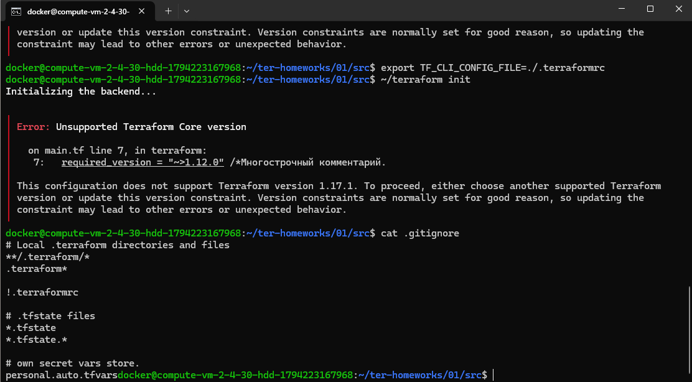
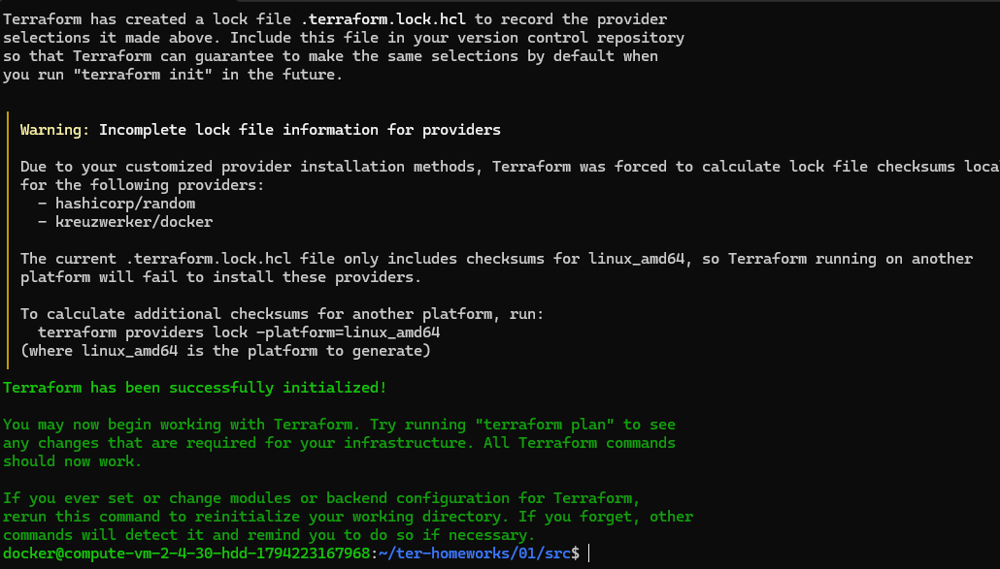
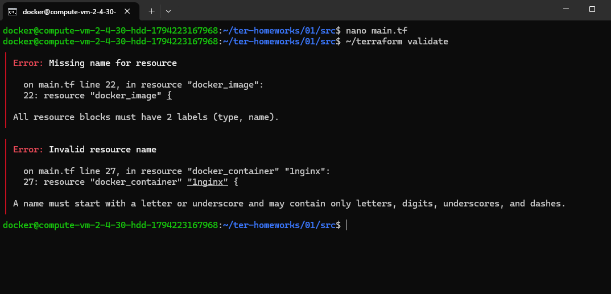
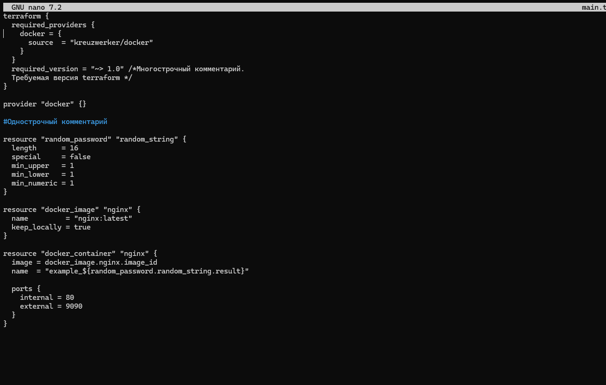
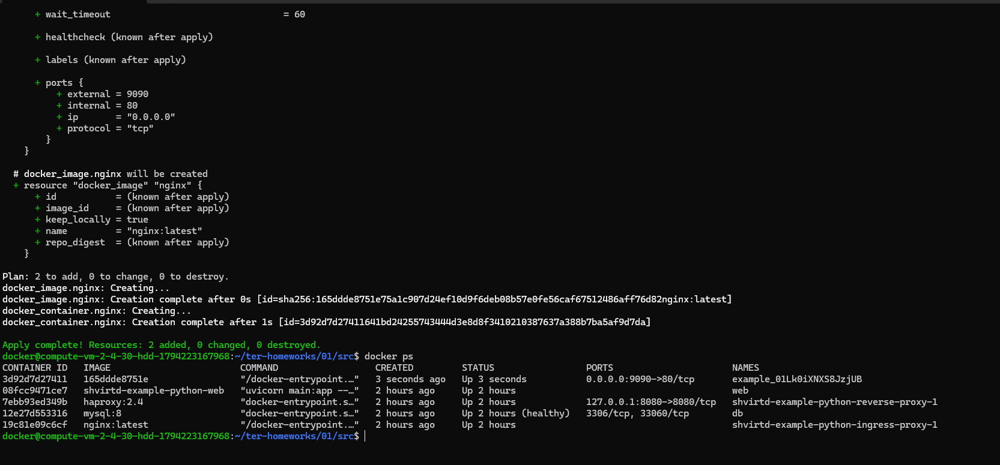
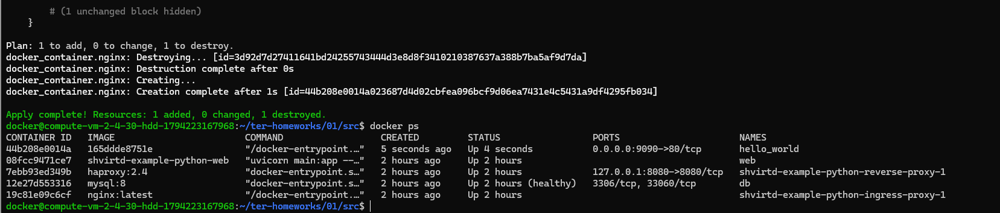
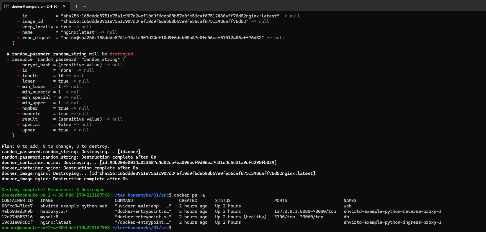
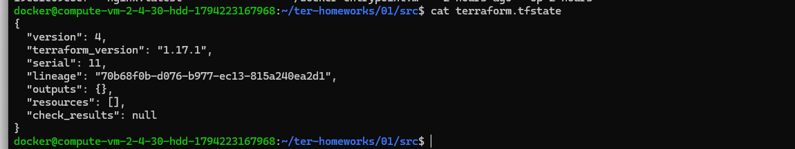

# Домашнее задание к занятию «Введение в Terraform» - Шичков Евгений

---

### Задание 1-2. Установка зависимостей и анализ `.gitignore` ( з

Перешел в каталог `src` и выполнил команду `terraform init` (провайдеры docker и random успешно скачались).
Изучил файл `.gitignore`. Согласно строкам 11–12, личную и секретную информацию (логины, пароли, ключи) допустимо сохранять в файле **`personal.auto.tfvars`**. Файлы с расширением `.tfstate` также игнорируются, так как они могут содержать секреты в открытом виде.

**Доказательство (вывод `cat .gitignore`):**



---

### Задание 3. Секретное содержимое в state-файле

После выполнения кода проекта (команда `terraform apply -auto-approve`) в файле `terraform.tfstate` было создано секретное значение ресурса `random_password`.
С помощью команды `grep '"result"' terraform.tfstate` я нашел нужный ключ:
- **Конкретный ключ:** `result`
- **Значение:** `01Lk0iXNXS8JzjUB`

**Доказательство (вывод команды grep):**


---

### Задание 4. Поиск и исправление ошибок в `main.tf`

При раскомментировании блока кода (строки 22–37) и выполнении `terraform validate` были выявлены следующие намеренно допущенные ошибки:
1. **Ошибка версии (строка 7):** `required_version = "~>1.12.0"`. Установленная версия Terraform (1.17.1) не поддерживает это ограничение. Исправлено на `~> 1.0`.
2. **Отсутствие имени ресурса (строка 22):** `Missing name for resource`. У ресурса `docker_image` не было второй метки (имени). Исправлено на `resource "docker_image" "nginx"`.
3. **Невалидное имя ресурса (строка 27):** Имя `1nginx` начинается с цифры, что запрещено в Terraform. Переименовано в `nginx`.
4. **Обращение к несуществующему ресурсу (строка 30):** В коде было указано `random_password.random_string_FAKE.result`. Суффикс `_FAKE` является опечаткой, ресурс называется `random_string`.

**Исправленный фрагмент кода:**
```hcl
resource "docker_image" "nginx" {
  name         = "nginx:latest"
  keep_locally = true
}

resource "docker_container" "nginx" {
  image = docker_image.nginx.image_id
  name  = "example_${random_password.random_string.result}"
  
  ports {
    internal = 80
    external = 9090
  }
}
```



### Задание 5. Переименование контейнера и анализ `-auto-approve`

Я изменил имя docker-контейнера в блоке кода на `hello_world` (при этом образ остался `nginx:latest`). После этого выполнил команду `terraform apply -auto-approve`. Terraform увидел изменение имени и пересоздал контейнер.

**Объяснение про ключ `-auto-approve`:**
*   **В чём опасность:** Ключ отключает интерактивное подтверждение плана (вопрос `Do you want to perform these actions?`). Опасность заключается в том, что Terraform молча применит любые изменения. Если в коде случайно допущена ошибка (например, удалено имя ресурса или изменен образ на несуществующий), Terraform без предупреждения удалит рабочие ресурсы. Это может привести к падению сервиса или потере данных без возможности отменить операцию.
*   **Зачем нужен:** Этот ключ незаменим при автоматизации. Когда Terraform запускается в CI/CD пайплайнах (GitLab CI, GitHub Actions) или внутри bash-скриптов (как `deploy.sh`), там некому нажимать `yes` в терминале. Ключ позволяет скрипту выполняться полностью автономно.

**Доказательство (вывод `docker ps` после переименования):**

*(На скриншоте видно, что имя контейнера теперь ровно `hello_world`)*

---

### Задание 6. Уничтожение ресурсов и state-файл

Я выполнил команду `terraform destroy -auto-approve`. Все созданные ресурсы (контейнер и пароль) были удалены.

Проверил командой `docker ps -a` — контейнера нет. Затем я посмотрел содержимое файла `terraform.tfstate`.

**Доказательство (содержимое `terraform.tfstate` после удаления):**

*(В файле теперь пустой массив `"resources": []`, так как всё уничтожено)*

---

### Задание 7. Почему образ `nginx:latest` не был удалён?

При выполнении `terraform destroy` Docker-образ `nginx:latest` остался на локальном диске сервера. Это произошло из-за параметра `keep_locally = true`, который прописан в блоке `docker_image` в файле `main.tf`.

Подтверждение из официальной документации Terraform (классификатор `resource docker_image`):
> **`keep_locally`** (Boolean) If true, then the Docker image won't be deleted on destroy operation. If this is false, it will delete the image from the docker local storage on destroy operation.
> 
> *(Перевод: Если true, то Docker-образ не будет удален при операции destroy. Если false, он удалит образ из локального хранилища Docker при операции destroy).*

**Доказательство (фрагмент кода `main.tf`):**



```hcl
resource "docker_image" "nginx" {
  name         = "nginx:latest"
  keep_locally = true # <--- Именно эта строка спасает образ от удаления
}
```

